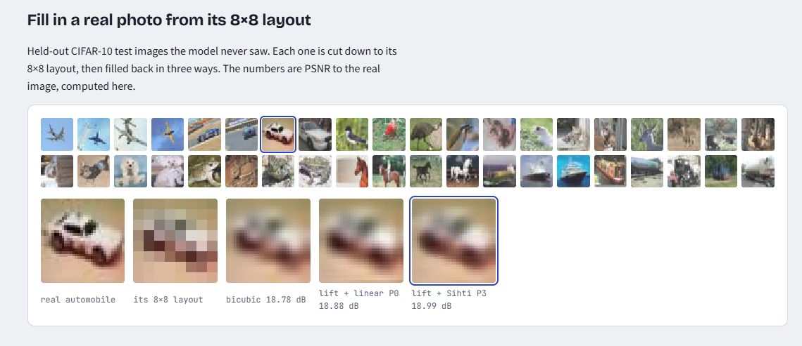
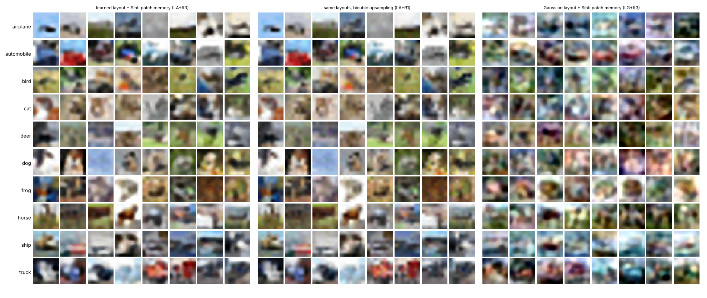

# SihtiImageModel2



[Try it live](https://anttiluode.github.io/SihtiImageModel2/web/index.html): pick a class, watch the
layout draw itself cell by cell, then watch the Sihti bands fill it in. Everything runs in the page.

A learned layout model with the [Sihti](https://github.com/anttiluode/Sihti) patch memory as its
detail stage. It is the successor to [SihtiImageModel](https://github.com/anttiluode/SihtiImageModel),
whose whole-image memory made good digits and colour fog on CIFAR-10, and whose conclusion was
that natural images need a global model of the layout, with the patch memory filling in below it.
This repo builds exactly that split and tests each half separately.

```
class -> layout model -> L (8x8x3)            the only learned part (a small transformer, backprop)
L -> lift -> x16                              one ridge map to Sihti's coarse state, core + r3
x16 -> patch memory -> r2, r1, r0             v1's P3: 512 codes per band, each a local linear map
image = x16 + r2 + r1 + r0                    32x32x3
```

## Run it

```
pip install -r requirements.txt
git clone --depth 1 https://github.com/YoongiKim/CIFAR-10-images data/cifar_png
#   or, with normal internet, the lossless original:  python -m sihti2.data --official
python fit_models.py        # palette, lift, patch memory, judge CNN, layout transformer (~80 min on 2 CPU cores)
python gates.py             # PREREG.md gates (~5 min)
python posthoc.py           # PREREG_STOCHASTIC.md gates + blurry-image judge (~20 min)
python figures.py
python export_web.py        # web/model.bin (5.2 MB, float16) + web/model.json
python -m pytest tests && python tests/make_parity_ref.py && node tests/test_web_parity.mjs
```

The layout transformer saves after every epoch and resumes if the machine restarts.

**Data used for the numbers below:** CIFAR-10 from the GitHub mirror above. It has the official
50 000 / 10 000 split but re-encoded as JPEG at quality about 75 with 4:2:0 chroma. The build
machine could not reach the Toronto site. JPEG removes part of the finest band, which is exactly
what the detail gates measure, so numbers on the official files will differ somewhat. The loader
prefers the official batches when they are present.

## Results (PREREG.md, committed before any gate ran)

**The kill condition on the layout fired (G1).** The judge did not read the learned layouts more
often than Gaussian ones. The detail stage passed its PSNR gate narrowly and failed on
recognition and on detail energy.

| gate | measured | pass if | |
|---|---|---|---|
| O1 real layouts, PSNR to the real image: Sihti P3 / linear P0 / bicubic | 21.47 / 21.37 / 21.35 dB | P3 >= P0 + 0.1 and > bicubic | **PASS** (+0.107 dB) |
| O2 judge reads the fill: P3 vs bicubic | 26.4% vs 25.1% | P3 >= bicubic + 2 pts | FAIL |
| G1 judge reads the requested class: learned layout vs Gaussian | 22.7% vs 24.1% | >= 35% and >= Gaussian + 10 | **FAIL, kill condition** |
| G2 FD to real images, learned layouts: P3 / P0 / bicubic / lift only | 110.2 / 111.6 / 118.5 / 148.0 | P3 < P0 < bicubic, P3 < lift | PASS |
| G2b fine-detail energy (sieve r0 + r1) vs real images | 0.115x | 0.6 - 1.4x | FAIL |
| G3 novelty ratio, near-copies | 1.03, 0% | >= 0.7, <= 2% | PASS |

Reference numbers: the judge (a small CNN trained on the sharp training images) reads 76.5% of
real test images. FD between two sets of real test images is 1.07. The lift reproduces Sihti's
coarse state from the 8x8 layout at 43.2 dB.

My predictions, from PREREG.md: P3 about +1.0 dB over bicubic (got +0.13); learned layouts
recognised 40% against Gaussian 20% (got 22.7% vs 24.1%); detail energy about 0.8x (got 0.115x).
All three were wrong in the optimistic direction.



### Reading it

**The layout is close to the ceiling the detail stage allows.** Real test images cut down to their
own 8x8 layout and filled by the same Sihti memory sit at FD 102 from real images. The learned
layouts sit at 110, and real-vs-real at 1. Nearly all of the distance to real photos is missing
detail, not a wrong layout.

**Why the detail is missing.** Each P3 code is a least-squares map, so it returns the *average*
residue for its kind of window. Averaging keeps edges, which line up across examples, and cancels
texture, which does not. `fig_stages.png` shows the bands drawing the right outlines (the car body,
the truck, the plane) at low amplitude. Even with the true layout the fill carries 11% of real
images' fine-band energy. The same regression-to-the-mean blur is the standard failure of
least-squares super-resolution, and the reason that field moved to adversarial and perceptual
losses (SRGAN, Ledig et al. 2017).

**Why G1 failed, and what the pictures say.** To the eye, the learned layouts are scenes: a red car
on a road, a plane against sky, ships on water, a brown horse. The Gaussian layouts are colour mush
(`fig_samples.png`, right panel). FD agrees with the eye (110 vs 117). The judge does not. It was
trained on sharp photos, and blurry images collapse onto three of its classes: per class it reads
bird 62%, cat 75%, ship 60%, and frog, horse, truck 0%. It reads only 26% of *real* photos filled
from their own layouts. The FAIL stands; the explanation came after the result.

## After the main gates (PREREG_STOCHASTIC.md, committed before its code was written)

Two follow-ups:
- **Arm R4: sampled detail.** Each code adds a draw from its own leftover residue covariance to its
  mean prediction, so the detail is sampled instead of averaged.
- **A judge for blurry images.** The same CNN, trained on bicubic-upsampled 8x8 layouts of the
  training images. It is post-hoc, so it carries no pass/fail.

| | mean detail R3 | sampled detail R4 | |
|---|---|---|---|
| S1 fine-detail energy vs real | 0.115x | 1.59x | FAIL (pass 0.6 - 1.4x) |
| S2 FD to real images, learned layouts | 110.2 | 97.7 | **PASS** |
| S3 PSNR on real layouts (a cost) | 21.47 dB | 17.55 dB | -3.9 dB (I predicted -1.5) |
| FD of real layouts' fills to other real images | 102.4 | 95.9 | |
| sharp judge, learned layouts / real layouts | 22.7% / 26.4% | 26.4% / 30.7% | |

Blurry-image judge (6 epochs, 60.2% on validation layouts):

| | read correctly |
|---|---|
| real test images, their 8x8 layouts (bicubic) | 61.1% |
| real layouts filled by the Sihti memory | 59.9% |
| real sharp images | 50.4% |
| learned layouts, bicubic / Sihti fill | 47.7% / 46.6% |
| Gaussian layouts, bicubic / Sihti fill | 55.0% / 53.2% |

Reading it:

- **Sampling moves samples toward real images but overshoots.** FD drops from 110 to 98, the judge
  reads more of them, and fine energy jumps from 0.12x to 1.59x. To the eye it is grain, not
  texture (`fig_sampled_detail.png`): each colour channel is sampled independently, so the noise
  comes out as coloured speckle, while real texture mostly varies in brightness. The sqrt(count)
  overlap rule also assumes neighbouring samples are independent, which inflates the energy.
- **The learned layouts carry most of a layout's class information.** The blurry-image judge reads
  real layouts at 61% and learned ones at 48%, about 78% of that ceiling. It reads Gaussian
  layouts *better* (55%). A Gaussian sample sits on its class's mean colours, which is what a
  classifier keys on. Classifier accuracy rewards stereotypes here, as it did in v1 on CIFAR,
  where memory samples were recognised more often than real test images.
- **Each judge is tied to its resolution.** The blurry-image judge reads sharp photos worse (50%)
  than blurred ones. Neither judge is a fair single score across both regimes. That is why FD and
  the figures carry weight in this README.

## What this leaves

- The split works as a pipeline: a learned layout plus the closed-form Sihti fill, all running live
  in a browser page at 5 MB.
- The layout half is near its ceiling at 8x8. The detail half is the open problem.
- The averaging fill is too smooth and the Gaussian-sampled fill is too grainy, which brackets the
  answer. Untested candidates:
  - sample in brightness only and keep colour from the mean;
  - copy real residue patches from the stored bank (v1's P1, example-based) instead of drawing
    Gaussian noise, so the texture is real texture;
  - a 16x16 layout, so less is left for the detail stage to invent.

## Prior art

Cascaded or multi-scale generation: LAPGAN (Denton et al. 2015); multiscale autoregressive models
(Reed et al. 2017; Menick & Kalchbrenner 2019, Subscale Pixel Networks); VQ-VAE-2 with a coarse
prior (Razavi et al. 2019); cascaded diffusion (Ho et al. 2022). Autoregressive pixel models:
PixelCNN (van den Oord et al. 2016). The detail stage is example-based super-resolution: Freeman,
Jones & Pasztor 2002; anchored neighbourhood regression (Timofte et al. 2013, A+ 2014), which is
very close to P3; RAISR (Romano et al. 2016). Regression-to-the-mean blur and the move to adversarial
SR: SRGAN (Ledig et al. 2017). FD in judge features follows FID (Heusel et al. 2017) but is not
comparable to published FID numbers, which use Inception features. What is this repo's: putting the
Sihti sieve's residue memory under a learned layout and measuring, with pre-registered gates, where
the split works (layout) and where it does not (detail).

## Corrections and incidents during the run

- `gates.py` first crashed at the FD step: newer scipy dropped `sqrtm(..., disp=)`. Fixed, then
  re-run. The real-layout gates are deterministic and reproduced identically; both runs are in
  `results/gate_log.txt`.
- The build machine restarted once, after the judge was trained and before the layout model
  started. The layout model was trained afterwards with per-epoch resume added. Nothing was
  re-fitted.

## Files

`sihti2/` the model (sieve and patch memory copied unchanged from v1; `layout.py`, `nets.py`,
`stochastic.py` new) · `fit_models.py` · `gates.py` · `posthoc.py` · `figures.py` · `export_web.py`
· `web/` the live page (`model.js` is a line-by-line port, checked against Python by
`tests/test_web_parity.mjs`) · `results/` logs, JSON and figures.
